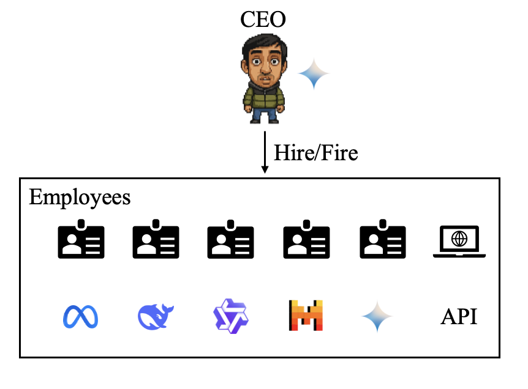

# HASHIRU: Hierarchical Agent System for Hybrid Intelligent Resource Utilization



## HASHIRU v2 (in development)

v2 rebuilds HASHIRU on open protocols. The CEO hires **managers** (which use tools and may hire) and
**workers** (which answer once), and every agent is its own **A2A** service. Every tool is served
over **MCP**. Each agent gets a dollar pool carved from its hirer's pool, and local Ollama agents also
count the memory their model really uses. Every LLM call, tool call and message is written to a JSONL
trace. The v1 code described below is preserved at tag
[`v1.0-paper`](https://github.com/HASHIRU-AI/HASHIRU/tree/v1.0-paper). The roadmap is in
[`plan/2026-10-29-modernize-mcp-a2a.md`](plan/2026-10-29-modernize-mcp-a2a.md).

Requires Python 3.13 and [uv](https://docs.astral.sh/uv/). Local models need [Ollama](https://ollama.com).

```bash
uv sync
ollama pull qwen3.5:4b                          # the default CEO and agent model; no API keys needed
uv run hashiru ask "Hire one worker on a local model and ask it to say hello."
uv run hashiru chat                             # talk to the CEO turn by turn
cp .env.example .env                            # for cloud models: set CEO_MODEL, MODELS and a provider key
uv run --env-file .env hashiru ask "..." budget_usd=1.0   # key=value overrides src/hashiru/conf/config.yaml
uv run pytest -q                                # no API keys or Ollama needed
```

**Tools.** Built in: hiring and firing, `check_usage`, `get_website`, `arxiv_search`, `read_file` (under
`data_dir`), `memory` (persistent, searchable, shared by sessions; set `memory_db=''` for a per-session copy) and
`deliver_to_user`. Any MCP server can add more: list it under `mcp_servers` in a config file and its tools appear to
agents as `<server>__<tool>`. See [`examples/hashiru.yaml`](examples/hashiru.yaml):

```bash
uv run hashiru chat --config examples/hashiru.yaml      # adds the official fetch server via uvx
```

A manager can be hired with only some tools: `hire_agent(..., tools=["memory", "ask_agent"])`.

**Budgets, modes and deadlines.** Budgets are enforced in code: a hire cannot reserve more than its hirer has
left, a local model must fit in free memory, and an agent whose pool is spent stops making cloud calls
(`enforce_budget=false` only records overspending, for policy experiments). `allow_hiring`,
`allow_local_agents` and `allow_cloud_agents` are v1's mode switches. Each user request has one deadline
(`task_timeout`) that every agent it reaches must meet; firing an agent or closing a session stops its work.

**Remote agents over A2A.** List other A2A agents under `a2a_peers` and managers can hire them as workers
(`a2a/<name>`), paid from their pools. A peer's price comes from its Agent Card through the
[HASHIRU cost extension](docs/a2a-cost-extension.md) or from your config; every agent HASHIRU hosts publishes
that extension too.

```yaml
a2a_peers:
  helper: {url: https://example.com/agent/, headers: {Authorization: "Bearer ${oc.env:HELPER_TOKEN}"}}
```

**Tool creation** (off by default). With `tool_creation=true`, managers can write new tools with
`create_tool`. Each tool runs as its own MCP server process under `uv run --with <its dependencies>`, without
HASHIRU's environment variables, and is offered to every agent from the next turn on. Created tools are shared
by all sessions on the hub, saved in `tools_dir`, and restart with the hub. This keeps a tool's packages away
from HASHIRU, but **it is not a sandbox**: the code runs as you, so it can read and write your files and inspect
your other processes. Only enable it when every session belongs to you and you trust the agents.

```bash
uv run hashiru ask "Create a tool that counts the days between two ISO dates, then use it for 2026-01-01 and 2026-10-29." \
  ceo_model=ollama_chat/gemma4:12b 'models=["ollama_chat/gemma4:12b"]' tool_creation=true
```

## Project Overview

This project provides a framework for creating and managing AI agents and tools. It includes features for managing resource and expense budgets, loading tools and agents, and interacting with various language models.

The architecture consists of a hierarchical system where a CEO agent manages a set of employee agents and tools. Both agents and tools can be autonomously created, invoked, and deleted by the CEO. Agents are associated with reclaimable costs (if local) and non-reclaimable costs (if cloud-based).

The project is designed to be modular and extensible, allowing users to integrate their own tools and agents. It supports multiple language model integrations, including Ollama, Gemini, Groq, and Lambda Labs.

NOTE: Benchmarking efforts of the HASHIRU architecture can be found in [HASHIRUBench](https://github.com/HASHIRU-AI/HASHIRUBench).

## Directory Structure

*   **src/**: Contains the source code for the project.
    *   **tools/**: Contains the code for the tools that can be used by the agents.
        *   **default\_tools/**: Contains the default tools provided with the project.
        *   **user\_tools/**: Contains the tools created by the user.
    *   **config/**: Contains configuration files for the project.
    *   **utils/**: Contains utility functions and classes used throughout the project.
    *   **models/**: Contains the configurations and system prompts for the agents. Includes `models.json` which stores agent definitions.
    *   **manager/**: Contains the core logic for managing agents, tools, and budgets.
        *   `agent_manager.py`: Manages the creation, deletion, and invocation of AI agents. Supports different agent types like Ollama, Gemini, and Groq.
        *   `budget_manager.py`: Manages the resource and expense budgets for the project.
        *   `tool_manager.py`: Manages the loading, running, and deletion of tools.
        *   `llm_models.py`: Defines abstract base classes for different language model integrations.
    *   **data/**: Contains data files, such as memory and secret words.

## Key Components

*   **Agent Management:** The `AgentManager` class in `src/manager/agent_manager.py` is responsible for creating, managing, and invoking AI agents. It supports different agent types, including local (Ollama) and cloud-based (Gemini, Groq) models.
*   **Tool Management:** The `ToolManager` class in `src/manager/tool_manager.py` handles the loading and running of tools. Tools are loaded from the `src/tools/default_tools` and `src/tools/user_tools` directories.
*   **Budget Management:** The `BudgetManager` class in `src/manager/budget_manager.py` manages the resource and expense budgets for the project. It tracks the usage of resources and expenses and enforces budget limits.
*   **Model Integration:** The project supports integration with various language models, including Ollama, Gemini, and Groq. The `llm_models.py` file defines abstract base classes for these integrations.

## Usage

To use the project, follow these steps:
1.  Install the required dependencies by running `pip install -r requirements.txt`.
2.  Start the application by running `python app.py`. This will launch a web interface where you can interact with the agents and tools.

By default, on running `python app.py`, you would need to authenticate with Auth0. But, this can be overriden through the CLI argument `--no-auth` to skip authentication.

To use the project with additional tools and agents, you need to:

1.  Configure the budget in `src/tools/default_tools/agent_cost_manager.py`.
2.  Create tools and place them in the `src/tools/default_tools` or `src/tools/user_tools` directories.

Please note that by default, we do provide a lot of pre-defined tools and agents, so you may not need to create your own tools unless you have specific requirements.

## Model Support
The project supports the following language model integrations:
- **Ollama**: Local model management and invocation.
- **Gemini**: Cloud-based model management and invocation from Google.
- **Groq**: Cloud-based model management and invocation from Groq.
- **Lambda**: Cloud-based model management and invocation from Lambda Labs.

## Acknowledgements
We would like to thank Hugging Face, Groq and Lambda Labs for sponsoring this project and providing the necessary resources for development.

## Citation
If you use this project in your research or applications, please cite it as follows:
```bibtex
@misc{hashiruai,
      title={HASHIRU: Hierarchical Agent System for Hybrid Intelligent Resource Utilization}, 
      author={Kunal Pai and Parth Shah and Harshil Patel},
      year={2025},
      eprint={2506.04255},
      archivePrefix={arXiv},
      primaryClass={cs.MA},
      url={https://arxiv.org/abs/2506.04255}, 
}
```

## Contributing

Contributions are welcome! Please submit pull requests with bug fixes, new features, or improvements to the documentation.