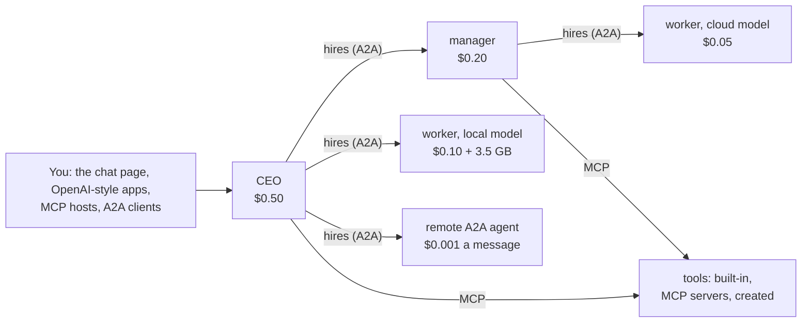

# HASHIRU: Hierarchical Agent System for Hybrid Intelligent Resource Utilization



HASHIRU is a budget-aware multi-agent system. A CEO agent splits your request into subtasks and hires
**managers** (which use tools and may hire) and **workers** (which answer once) on local and cloud models. Each
hire gets a dollar pool carved from its hirer's pool, and local Ollama agents also count the memory their model
really uses.

v2 (in development on `develop`) rebuilds HASHIRU on open protocols. Every agent is its own **A2A** service and
every tool is served over **MCP**, and HASHIRU itself is reachable as an OpenAI-compatible model, an A2A agent and
an MCP server. Every LLM call, tool call and message is written to a JSONL trace. The v1 code from the paper is
preserved at tag [`v1.0-paper`](https://github.com/HASHIRU-AI/HASHIRU/tree/v1.0-paper); the v2 roadmap is in
[`plan/2026-10-29-modernize-mcp-a2a.md`](plan/2026-10-29-modernize-mcp-a2a.md), and how the parts fit is in
[`docs/architecture.md`](docs/architecture.md). Benchmarks of v1 are in
[HASHIRUBench](https://github.com/HASHIRU-AI/HASHIRUBench).

## Quickstart

Requires Python 3.13 and [uv](https://docs.astral.sh/uv/). Local models need [Ollama](https://ollama.com); HASHIRU runs
them with a 16K-token context window (`ollama_num_ctx`), since Ollama's default 4K fills up after a few agents' replies.

```bash
uv sync
ollama pull qwen3.5:4b                          # the default CEO and agent model; no API keys needed
uv run hashiru serve                            # chat at http://127.0.0.1:9200
uv run hashiru ask "Hire one worker on a local model and ask it to say hello."
uv run hashiru chat                             # the same, turn by turn in the terminal
cp .env.example .env                            # for cloud models: set CEO_MODEL, MODELS and a provider key
uv run --env-file .env hashiru serve budget_usd=1.0   # key=value overrides src/hashiru/conf/config.yaml
uv run pytest -q                                # no API keys or Ollama needed
uv run --with playwright pytest tests/test_ui_browser.py   # optional: the chat page in your installed Chrome
```

`hashiru serve` puts everything on one port: a chat page at `/`, where an **Agents** panel shows the hiring tree,
each pool and the agents' messages as they happen, plus the three interfaces below.

## Use HASHIRU from other apps

**As an OpenAI-compatible model.** `/v1/chat/completions` (streaming or not) and `/v1/models` serve one model,
`hashiru`, so any OpenAI-style chat app (Open WebUI, LibreChat, ...) or SDK can talk to the CEO. While the
agents work, their hires, messages and tool calls stream as `reasoning_content`, which these apps show as the
model's thinking; the answer arrives as `content`. A chat continues one conversation (its agents stay hired) as
long as the app sends back the replies it got; an edited or regenerated message starts a new one, which is shown
the chat so far.

```python
from openai import OpenAI
client = OpenAI(base_url="http://127.0.0.1:9200/v1", api_key="unused")  # or your HASHIRU_API_KEY
print(client.chat.completions.create(model="hashiru", messages=[{"role": "user", "content": "..."}])
      .choices[0].message.content)
```

**As an MCP server** for Claude Code, Cursor and other MCP hosts, at `/public/mcp`. `ask` sends a message to the
CEO (the agents' work arrives as progress notifications; pass the returned `session` to continue), `end_session`
fires a session's agents, and the resource `hashiru://sessions/{session}` shows its agents and pools.

```bash
claude mcp add --transport http hashiru http://127.0.0.1:9200/public/mcp
```

**As an A2A agent.** The CEO's Agent Card is at `/.well-known/agent-card.json` and the JSON-RPC endpoint at
`/a2a`. Messages in one A2A context continue one conversation; with streaming, progress arrives as `working`
status updates, and the reply reports its cost through the [HASHIRU cost extension](docs/a2a-cost-extension.md).

**Access.** Without an `api_key`, HASHIRU listens on loopback only and answers only requests addressed to
`127.0.0.1` or `localhost` from no web page or a page on this machine, so a website open in your browser cannot
use it. To serve other machines or containers, set `HASHIRU_API_KEY` (and `host=0.0.0.0`): clients then send it as
`Authorization: Bearer <key>`, and the chat page asks for it once. Up to `max_sessions` conversations stay open;
an idle one closes after `session_ttl` seconds, firing its agents.

## Tools

Built in: hiring and firing, `check_usage`, `get_website`, `arxiv_search`, `read_file` (under `data_dir`),
`memory` (persistent, searchable, shared by sessions; set `memory_db=''` for a per-session copy) and
`deliver_to_user`. Any MCP server can add more: list it under `mcp_servers` in a config file and its tools appear
to agents as `<server>__<tool>`. See [`examples/hashiru.yaml`](examples/hashiru.yaml) and
[`examples/`](examples/README.md), which has a small MCP server and a priced A2A agent to start from:

```bash
uv run examples/calc_a2a_agent.py --port 9300            # a remote agent the config lists as a2a/calc
uv run hashiru serve --config examples/hashiru.yaml      # adds the fetch and clock MCP servers and calc
```

A manager can be hired with only some tools: `hire_agent(..., tools=["memory", "ask_agent"])`.

## Budgets, modes and deadlines

Budgets are enforced in code: a hire cannot reserve more than its hirer has left, a local model must fit in free
memory, and an agent whose pool is spent stops making cloud calls (`enforce_budget=false` only records
overspending, for policy experiments). `max_usd` caps real API spend for the whole process. `allow_hiring`,
`allow_local_agents` and `allow_cloud_agents` are v1's mode switches. Each user request has one deadline
(`task_timeout`) that every agent it reaches must meet; firing an agent or closing a conversation stops its work.

## Remote agents over A2A

List other A2A agents under `a2a_peers` and managers can hire them as workers (`a2a/<name>`), paid from their
pools. A peer's price comes from its Agent Card through the [HASHIRU cost extension](docs/a2a-cost-extension.md)
or from your config; every agent HASHIRU hosts publishes that extension too.

```yaml
a2a_peers:
  helper: {url: https://example.com/agent/, headers: {Authorization: "Bearer ${oc.env:HELPER_TOKEN}"}}
  team_b: {url: http://127.0.0.1:9201/a2a}   # another HASHIRU hub: its CEO and its hires, as one worker
```

The hub reads a peer's card from `<url>/.well-known/agent-card.json` and sends messages only to `<url>`. Since a
hub is itself an A2A agent at `/a2a`, one hub can hire another; [`examples/README.md`](examples/README.md#two-hubs)
shows how.

## Tool creation (off by default)

With `tool_creation=true`, managers can write new tools with `create_tool`. Each tool runs as its own MCP server
process under `uv run --with <its dependencies>`, without HASHIRU's environment variables, and is offered to every
agent from the next turn on. Created tools are shared by all sessions on the hub, saved in `tools_dir`, and restart
with the hub. This keeps a tool's packages away from HASHIRU, but **it is not a sandbox**: the code runs as you, so
it can read and write your files and inspect your other processes, and under `hashiru serve` without an `api_key` it
can open conversations through the local API (each with a fresh `budget_usd`; only `max_usd` still caps them). Only
enable it when every session belongs to you and you trust the agents, and set an `api_key` when you serve with it.

```bash
uv run hashiru ask "Create a tool that counts the days between two ISO dates, then use it for 2026-01-01 and 2026-10-29." \
  ceo_model=ollama_chat/gemma4:12b 'models=["ollama_chat/gemma4:12b"]' tool_creation=true
```

## Hugging Face Spaces and containers

The [`Dockerfile`](Dockerfile) runs `hashiru serve` on port 7860 as a Hugging Face Docker Space (this README's
front matter configures one). Add Space secrets `HASHIRU_API_KEY`, `CEO_MODEL`, `MODELS` and the provider key
your models need; a Space has no Ollama, so use cloud models. The chat page, API, A2A agent and MCP server all
share the Space's URL, and HASHIRU's internal agent and tool routes stay behind per-session tokens.

## Layout

```
src/hashiru/
  hub.py, auth.py        one process, one port: sessions, agents' A2A endpoints, tools' MCP endpoint, the gate
  runtime.py, ledger.py  the agent loop, ask_agent, pools; trace.py writes every event
  tools.py, web.py, memory.py, gateway.py, mcplink.py   built-in tools and third-party MCP servers
  toolsmith/             tool creation
  peers.py               remote A2A agents and the cost extension
  interop/               the chat page's API: OpenAI-compatible /v1, public A2A agent, public MCP server
  ui/                    the chat page (static files, no build step)
  conf/config.yaml       every setting, with comments
docs/                    architecture, the A2A cost extension
examples/                a config file, an MCP server and an A2A agent (tested in tests/test_examples.py)
```

## Acknowledgements
We would like to thank Hugging Face, Groq and Lambda Labs for sponsoring this project and providing the necessary resources for development.

## Citation
If you use this project in your research or applications, please cite the paper (also in
[`CITATION.cff`](CITATION.cff), which GitHub's "Cite this repository" reads):
```bibtex
@misc{hashiruai,
      title={HASHIRU: Hierarchical Agent System for Hybrid Intelligent Resource Utilization}, 
      author={Kunal Pai and Parth Shah and Harshil Patel},
      year={2025},
      eprint={2506.04255},
      archivePrefix={arXiv},
      primaryClass={cs.MA},
      url={https://arxiv.org/abs/2506.04255}, 
}
```

## Contributing

Contributions are welcome! Please submit pull requests with bug fixes, new features, or improvements to the documentation.
