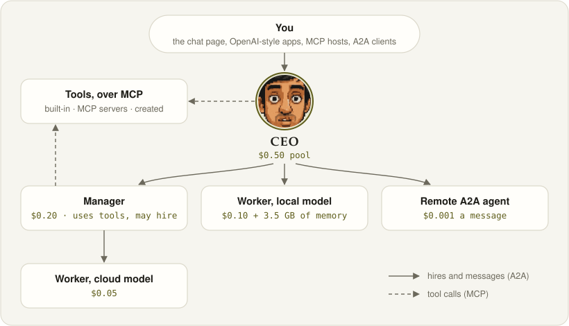
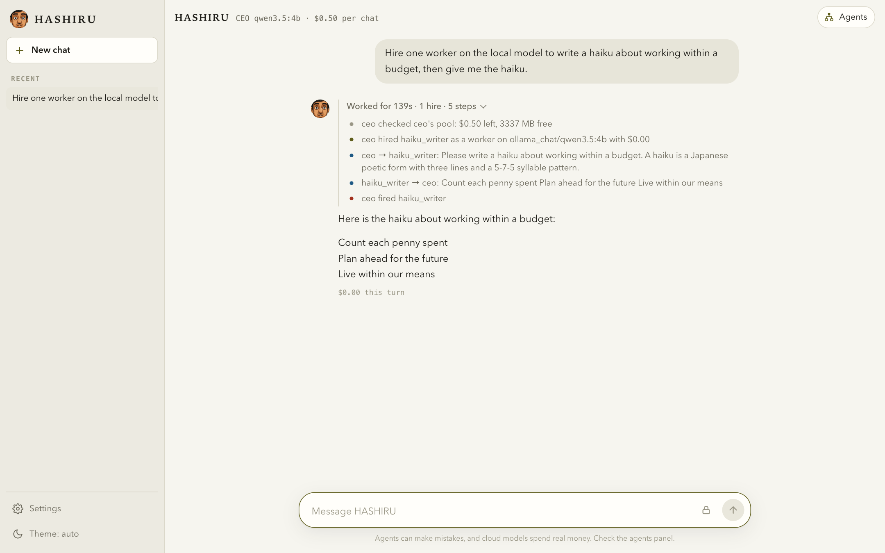
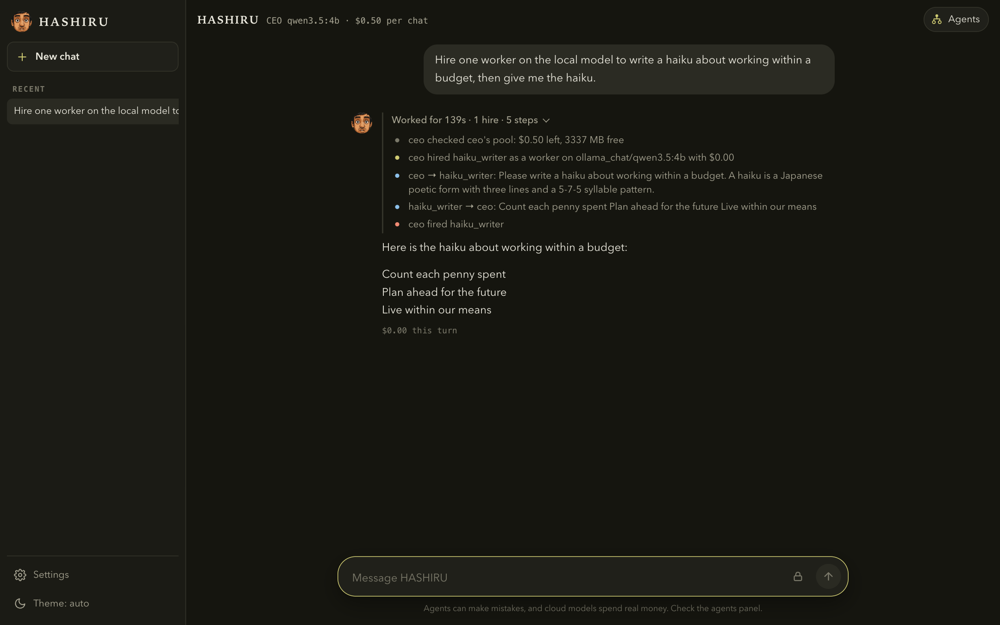
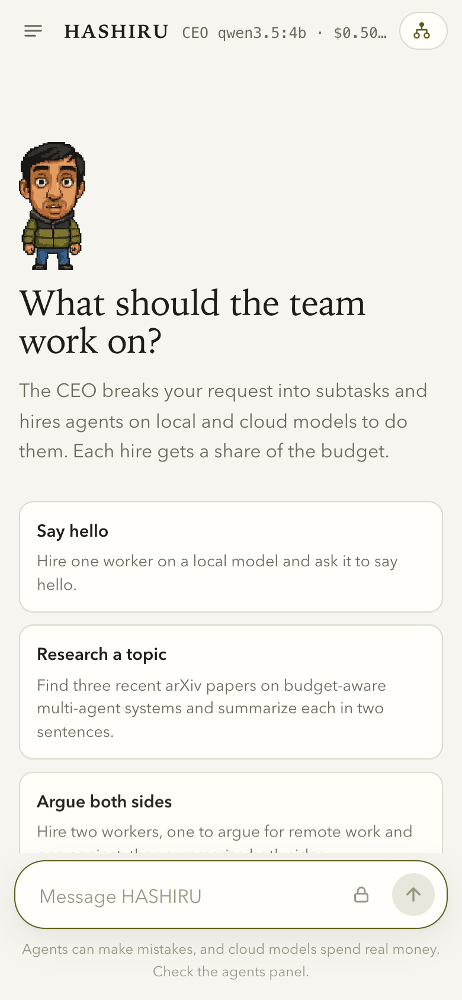
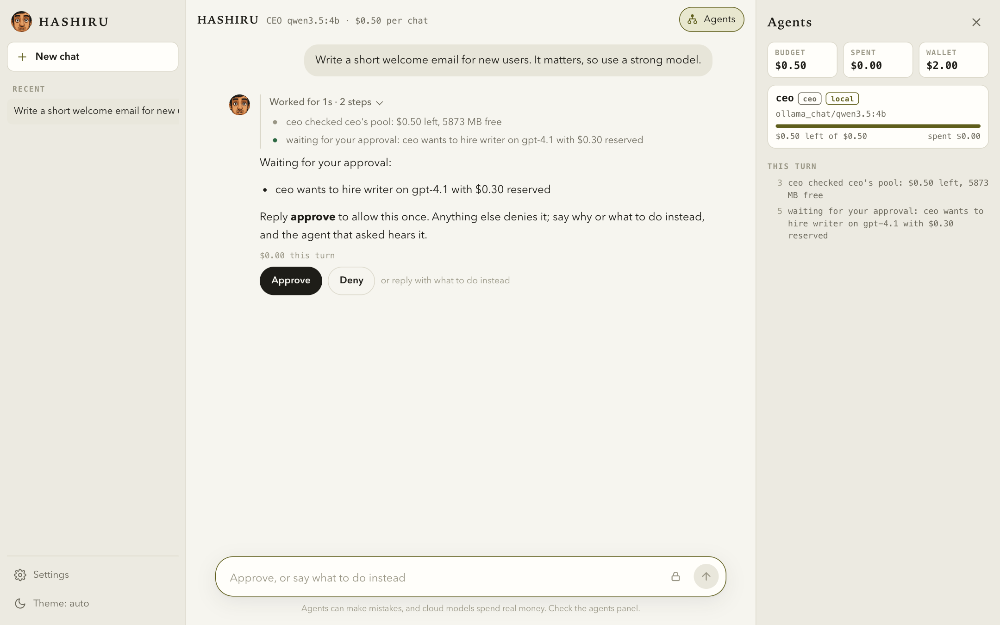
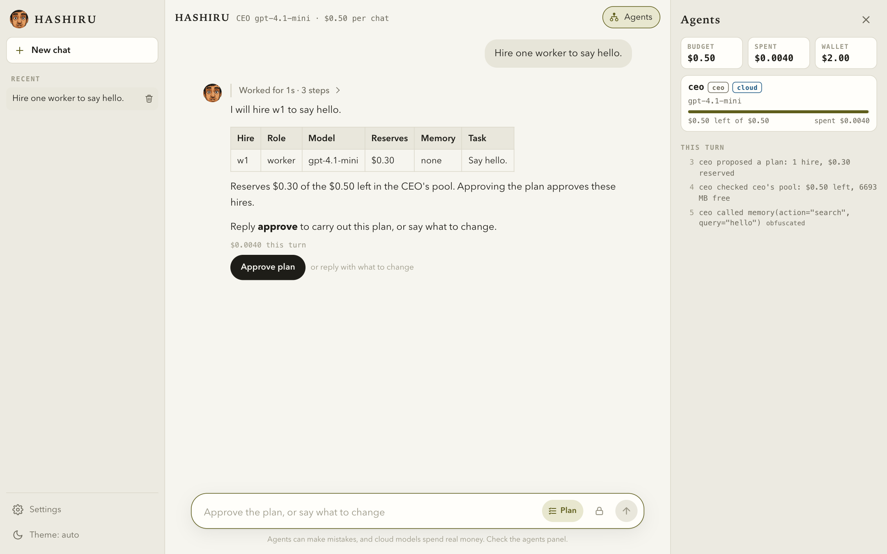
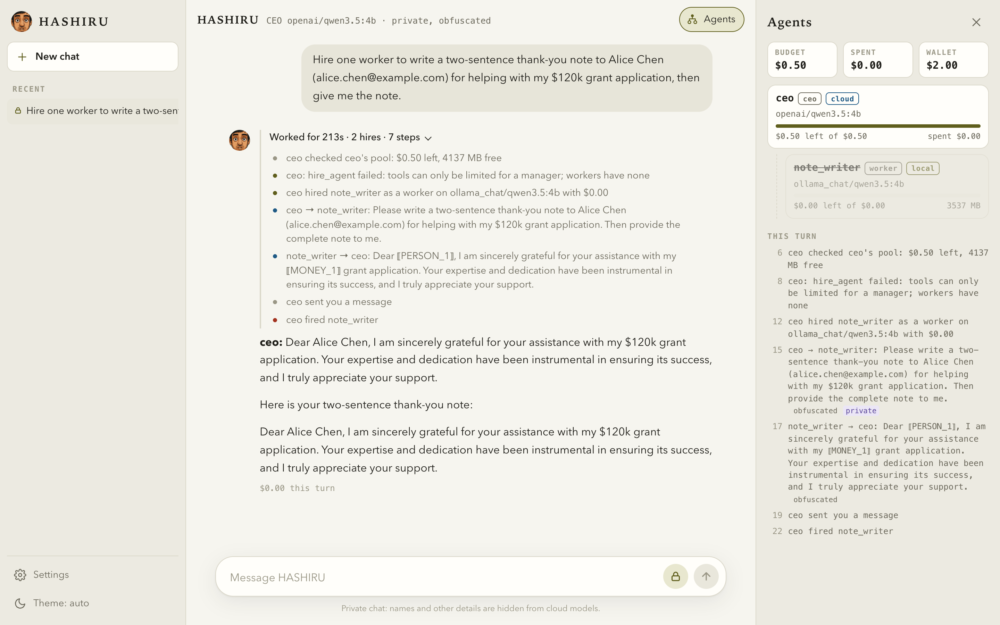
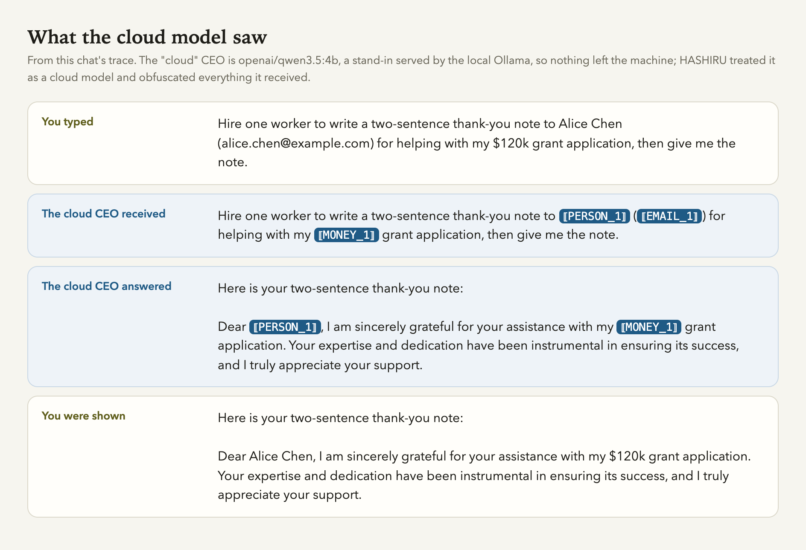

<p align="center"></p>

# HASHIRU: Hierarchical Agent System for Hybrid Intelligent Resource Utilization

<p align="center"></p>

HASHIRU is a budget-aware multi-agent system. A CEO agent splits your request into subtasks and hires
**managers** (which use tools and may hire) and **workers** (which answer once) on local and cloud models. Each
hire gets a dollar pool carved from its hirer's pool, and local Ollama agents also count the memory their model
really uses.

v2 (in development on `develop`) rebuilds HASHIRU on open protocols. Every agent is its own **A2A** service and
every tool is served over **MCP**, and HASHIRU itself is reachable as an OpenAI-compatible model, an A2A agent and
an MCP server. Every LLM call, tool call and message is written to a JSONL trace. The v1 code from the paper is
preserved at tag [`v1.0-paper`](https://github.com/HASHIRU-AI/HASHIRU/tree/v1.0-paper); the v2 roadmap is in
[`plan/2026-10-29-modernize-mcp-a2a.md`](plan/2026-10-29-modernize-mcp-a2a.md), and how the parts fit is in
[`docs/architecture.md`](docs/architecture.md). Benchmarks of v1 are in
[HASHIRUBench](https://github.com/HASHIRU-AI/HASHIRUBench).

## Quickstart

Requires Python 3.13 and [uv](https://docs.astral.sh/uv/). Local models need [Ollama](https://ollama.com); HASHIRU runs
them with a 16K-token context window (`ollama_num_ctx`), since Ollama's default 4K fills up after a few agents' replies.

```bash
uv sync
ollama pull qwen3.5:4b                          # the default CEO and agent model; no API keys needed
uv run hashiru serve                            # chat at http://127.0.0.1:9200
uv run hashiru ask "Hire one worker on a local model and ask it to say hello."
uv run hashiru chat                             # the same, turn by turn in the terminal
cp .env.example .env                            # for cloud models: set CEO_MODEL, MODELS and a provider key
uv run --env-file .env hashiru models           # what this machine can use, and what MODELS=auto would pick
uv run --env-file .env hashiru serve budget_usd=1.0   # key=value overrides src/hashiru/conf/config.yaml
uv run pytest -q                                # no API keys or Ollama needed
uv run --with playwright pytest tests/test_ui_browser.py   # optional: the chat page in your installed Chrome
```

`hashiru serve` puts everything on one port: a chat page at `/`, where an **Agents** panel shows the hiring tree,
each pool and the agents' messages as they happen, plus the three interfaces below.

<p align="center"></p>
<p align="center"> </p>
<p align="center"><sub>A real run on a local model (qwen3.5:4b): the CEO hires a worker, asks it, fires it and answers.
The activity above the answer lists every step. Dark mode and phone width on the right.</sub></p>

## Use HASHIRU from other apps

**As an OpenAI-compatible model.** `/v1/chat/completions` (streaming or not) and `/v1/models` serve one model,
`hashiru`, so any OpenAI-style chat app (Open WebUI, LibreChat, ...) or SDK can talk to the CEO. While the
agents work, their hires, messages and tool calls stream as `reasoning_content`, which these apps show as the
model's thinking; the answer arrives as `content`. A chat continues one conversation (its agents stay hired) as
long as the app sends back the replies it got; an edited or regenerated message starts a new one, which is shown
the chat so far.

```python
from openai import OpenAI
client = OpenAI(base_url="http://127.0.0.1:9200/v1", api_key="unused")  # or your HASHIRU_API_KEY
print(client.chat.completions.create(model="hashiru", messages=[{"role": "user", "content": "..."}])
      .choices[0].message.content)
```

**As an MCP server** for Claude Code, Cursor and other MCP hosts, at `/public/mcp`. `ask` sends a message to the
CEO (the agents' work arrives as progress notifications; pass the returned `session` to continue), `end_session`
fires a session's agents, and the resource `hashiru://sessions/{session}` shows its agents and pools.

```bash
claude mcp add --transport http hashiru http://127.0.0.1:9200/public/mcp
```

**As an A2A agent.** The CEO's Agent Card is at `/.well-known/agent-card.json` and the JSON-RPC endpoint at
`/a2a`. Messages in one A2A context continue one conversation; with streaming, progress arrives as `working`
status updates, and the reply reports its cost through the [HASHIRU cost extension](docs/a2a-cost-extension.md).

**Access.** Without an `api_key`, HASHIRU listens on loopback only and answers only requests addressed to
`127.0.0.1` or `localhost` from no web page or a page on this machine, so a website open in your browser cannot
use it. To serve other machines or containers, set `HASHIRU_API_KEY` (and `host=0.0.0.0`): clients then send it as
`Authorization: Bearer <key>`, and the chat page asks for it once. Up to `max_sessions` conversations stay open;
an idle one closes after `session_ttl` seconds, firing its agents.

## Tools

Built in: hiring and firing, `check_usage`, `get_website`, `arxiv_search`, `read_file` (under `data_dir`),
`memory` (persistent, searchable, shared by sessions; set `memory_db=''` for a per-session copy) and
`deliver_to_user`. Any MCP server can add more: list it under `mcp_servers` in a config file and its tools appear
to agents as `<server>__<tool>`. See [`examples/hashiru.yaml`](examples/hashiru.yaml) and
[`examples/`](examples/README.md), which has a small MCP server and a priced A2A agent to start from:

```bash
uv run examples/calc_a2a_agent.py --port 9300            # a remote agent the config lists as a2a/calc
uv run hashiru serve --config examples/hashiru.yaml      # adds the fetch and clock MCP servers and calc
```

A manager can be hired with only some tools: `hire_agent(..., tools=["memory", "ask_agent"])`.

## Budgets, modes and deadlines

Budgets are enforced in code: a hire cannot reserve more than its hirer has left, a local model must fit in free
memory, and an agent whose pool is spent stops making cloud calls (`enforce_budget=false` only records
overspending, for policy experiments). `max_usd` caps real API spend for the whole process. `allow_hiring`,
`allow_local_agents` and `allow_cloud_agents` are v1's mode switches. Each user request has one deadline
(`task_timeout`) that every agent it reaches must meet; firing an agent or closing a conversation stops its work.

## Hiring by difficulty

A hiring agent says how hard a job is instead of picking a model: `hire_agent(..., difficulty="easy" | "medium" |
"hard")`. The hub turns that into the models the hire may run on, best first, and hires the first one that fits: an
easy job tries small local models, then cheap cloud ones; a medium job large local models, then cheap cloud ones; a
hard job the dearest cloud models, then large local ones. Set your own order per difficulty with `routing`, e.g.
`routing: {hard: [gpt-4.1, ollama_chat/gemma4:12b]}`. The list keeps only what the modes allow and what the hire's
privacy and pool allow: a hirer holding private data gets local models first (only local ones with
`private_mode=block`), and a hire with `budget_usd: 0` gets local models only. A worker that fails or answers empty
moves up its list and gets the message again, up to `max_escalations` times per message (2 by default), shown in the
chat's activity; a worker holding private data never moves to a cloud model. Naming a `model` still works.

## Which models you can use (`hashiru models`, `MODELS=auto`)

`hashiru models` shows the models this machine can use right now: every model Ollama has pulled that calls tools, and
every cloud chat model in [LiteLLM's model map](https://github.com/BerriAI/litellm/blob/main/model_prices_and_context_window.json)
whose provider key is set in the environment (run it with `uv run --env-file .env`). Each one gets a tier from its
price per million output tokens (under $2 easy, under $10 medium, else hard) or, for a local model, its size (under
8B easy, under 30B medium, else hard), with its context window, prices and whether it reasons. The list leaves out
what an agent cannot use: models that cannot call tools, embedding, audio, search, realtime and other special-purpose
models, fine-tunes, floating `-latest` and `-exp` names, models LiteLLM prices at $0 or has retired, and dated
snapshots whose alias is there too.

```bash
uv run --env-file .env hashiru models            # the picks (*); --all lists every usable model
uv run --env-file .env hashiru models --refresh  # download LiteLLM's newest map first (new models, new prices)
uv run --env-file .env hashiru models --check    # ask each provider which models your key can use
MODELS=auto uv run --env-file .env hashiru serve  # hire from the picks, with routing built from their tiers
```

With `MODELS=auto` the hub hires from every usable local model and, per provider and tier, the best
`auto_per_tier` (1) cloud models costing at most `auto_max_usd` ($30) per million output tokens: reasoning models
first, then the cheapest (easy, medium) or the dearest (hard). `routing` is built from the tiers: a job tries its own
tier, then the ones above (so a failing worker moves up), then the ones below; leave `routing` out with `auto`, or
name your models to set it yourself. `hashiru serve` prints what it picked. The CEO's model stays yours to name.

Only `--refresh` and `--check` use the network: the first downloads a public JSON file, the second calls each
provider's model list with your key (nothing runs, nothing is billed); both write `model_catalog.json`. Starting the
hub reads that file, the environment and Ollama, and a refreshed map also prices models you name yourself. Keys are
looked for only for providers that take one API key from the environment (OpenAI, Anthropic, Gemini, Groq, Mistral,
DeepSeek, xAI, OpenRouter, Together, Fireworks and a few more; `recon.KEYED`); for Bedrock, Vertex AI, Azure and the
like, name the models in `MODELS`. (LiteLLM's own key check for GitHub Copilot starts a GitHub login and waits, so it
is never asked.)

## Approvals before a big spend

Three kinds of spending wait for you:

- a hire that reserves `approve_hire_usd` or more ($0.25 by default) for a cloud model or a remote agent;
- a hire or an escalation that loads a local model needing `approve_hire_mb` of memory or more (16384 MB), unless
  it is loaded already;
- a turn whose calls have cost `approve_turn_usd` ($0.25), and again at each further $0.25.

The agent that would spend pauses while the rest of the turn goes on, and the reply asks, e.g. "Waiting for your
approval: ceo wants to hire w1 on gpt-4.1 with $0.30 reserved". Your next message decides. `approve` (or yes, ok)
allows it once. Anything else denies it, and a hirer that is denied hears your words, so "no, use a local model"
works; in a private chat a cloud hirer hears them obfuscated.

<p align="center"></p>
<p align="center"><sub>A hard job, so the router picked gpt-4.1; the $0.30 reservation waits for you (scripted models).</sub></p>

- **The chat page** shows Approve and Deny buttons.
- **The APIs** carry the questions with the answer: `hashiru.approval` on `/v1`, `approval` from MCP `ask`, and
  `hashiru_approval` in A2A reply metadata. The next message in the same conversation answers them.
- **`hashiru chat` and `hashiru ask`** ask on the terminal.

A question nobody answers by the turn's deadline is denied, and so is every question when nobody can answer
(`hashiru ask` in a script). Set a threshold to 0 to never ask. Whoever sends the next message decides: over the
APIs, that is whoever holds the API key, including another hub that hired this one (its agents may approve).

## Plan before acting

In plan mode the CEO researches the request and proposes a plan, but hires nobody and spends nothing on agents. It
may use only tools that read: `check_usage`, `get_website`, `arxiv_search`, `read_file`, `memory` (search and list)
and the tools of MCP servers that declare them read-only (`readOnlyHint`, taken at the server's word). Everything
else (hiring, firing, messaging agents, `deliver_to_user`, saving memories, created tools) is refused in code, not
just discouraged in the prompt. The plan names each hire with a role, a difficulty or a model, a budget and a task,
and the hub previews each one as `hire_agent` would make it now: the model the router picks, what it reserves and the
memory a local model takes, with the totals checked against the CEO's pool. The numbers come from the hub, not the
model.

The plan also gives the work as steps: each step sends one agent a task, and `after` names the steps whose results
it needs (they are added to its message). Without steps, each hire gets its own task once. A step may also go to an
agent hired in an earlier turn.

The reply shows the plan as a table and waits. `approve` (or yes, ok) carries it out, and the planned hires (same
name and model, no bigger budget) need no further approval; a hire outside the plan, a big escalation or a turn's
spending still asks. Anything else is feedback, and the CEO revises the plan.

**An approved plan runs as a graph.** The hub compiles the steps into a [LangGraph](https://github.com/langchain-ai/langgraph)
graph and adds the nodes the CEO would otherwise have to remember: a hire for each planned agent (all at once, as the
plan's totals were checked together), each step once every step it needs is done (in parallel where they can), a
fire after each hire's last step (its unspent money goes back and a local model is unloaded), and the CEO's answer,
one turn with every step's result. A step whose hire was refused fails, a step that needs a failed or skipped step is
skipped, and the rest still run; the answer says what happened. Every hire, message and fire goes through the same
paths as the CEO's own calls, so private data, budgets, escalation and approvals work as before, and each step's end
is a `step` event in the trace with an activity line. Steps that wait for each other, or name an agent or a step that
does not exist, are problems the CEO sees in `propose_plan`'s answer; a plan that does not compile is carried out by
the CEO as before. The plan carries its graph as Mermaid (`graph`, next to `steps`). `plan_execution=ceo` (or
`HASHIRU_PLAN_EXECUTION=ceo`) keeps the CEO in charge of carrying out the plan. LangSmith tracing stays off for these
graphs whatever the environment says, because it would send step results off the machine.

<p align="center"></p>
<p align="center"><sub>A plan waiting for approval (scripted models): nothing is hired yet.</sub></p>

- **The chat page:** the Plan switch beside the message box. Approving a plan turns it off.
- **Any client:** start a message with `/plan` or `/act`, e.g. `/plan compare these two papers`.
- **The APIs:** `x-hashiru-mode: plan` (or `act`) with `/v1/chat/completions`, `hashiru_mode` in an A2A message's
  metadata, `mode` for MCP `ask`. A proposed plan comes back as `hashiru.plan`, `hashiru_plan` and `plan`.
- **`hashiru chat`:** `/plan ...`, then `approve`. `hashiru ask "/plan ..."` prints the plan and stops.

Without a mode, a message continues planning while a plan waits, and a new request starts in `default_mode` (`act`;
`plan` plans every new request first). `/act` or act mode leaves plan mode and drops the plan. Planning costs the CEO's
own turns, and the plan shows reservations, not what each agent will spend within them. A plan covers the CEO's own
hires; a manager's hires within its pool ask as before.

## Private data

Some data is private: what `read_file` and `memory` return, memories that `memory_autoinject` adds, results of MCP
servers configured with `labels: [private]`, and everything you say in a private chat. HASHIRU labels it `private`,
follows it through every message and hire, and enforces one rule in code (R3 from HASHIRU-lite, *private stays
local*): a cloud or remote model never sees private data as it is.

**Obfuscation** (`private_mode=obfuscate`, the default). Before private text reaches a cloud or remote agent (in a
message, a reply, a hire prompt or a tool result), HASHIRU finds its sensitive values with
[Presidio](https://microsoft.github.io/presidio/)'s pattern recognizers (contact details, card, account and ID
numbers, IPs, URLs, dates, plus API keys and private keys) and a local model (names, places, employers, health and
money details), and replaces them: identifiers with placeholders such as `⟦PERSON_1⟧`, the same one for the same value
throughout the chat, and amounts, dates, ages and health details with vague descriptions ("a six-figure amount"), so
the cloud model can still reason about them. When a reply comes back to you, a local agent or a local tool, the
placeholders are restored: you see the real names, and only your machine knows them. If the local model cannot
answer, that text is refused rather than sent. `obfuscate_with=patterns` uses Presidio alone (no model call, but
names are not found). Obfuscation is best effort: a detail that neither the patterns nor the model recognize goes
through as written.

<p align="center"></p>
<p align="center"></p>
<p align="center"><sub>A real private chat (local models only: the "cloud" CEO was a stand-in, qwen3.5:4b served by the local
Ollama, which HASHIRU treated as a cloud model). The local worker saw the real details; the CEO saw placeholders; you
see the note as written. Below it, the same turn from the trace.</sub></p>

**Blocking** (`private_mode=block`). Cloud and remote agents never see private data at all: it is refused to them, a
cloud CEO cannot use `memory` or `read_file`, and a private chat's CEO moves to a local model (`private_ceo_model`; by
default `ceo_model` if it is local, else the first local model in `models`). Without a local model for the detector,
`obfuscate` falls back to this.

In both modes an agent holding private data may not call a tool that sends data off the machine: `get_website`,
`arxiv_search`, `create_tool`, created tools, and MCP servers unless their config says `egress: false`
(`private_egress=allow` lifts this). Refusals are `policy` events in the trace and show in the chat's activity.

To make a chat private, click the lock beside the message box, send `x-hashiru-private: 1` with
`/v1/chat/completions`, set `hashiru_private: true` in an A2A message's metadata, or pass `private: true` to the MCP
`ask` tool; `private_by_default=true` makes every chat private. A chat stays private from then on, also when its
conversation closes and the client continues it. The hub remembers private chats only until it restarts, so clients
should send the flag with every message (the chat page does). A chat also becomes private when a local agent shows you
private data with `deliver_to_user`, since the chat's history now holds it.

What R3 does not cover:

- **Tool creation.** Created tools run as you, unsandboxed, and can read your files and send them anywhere, so R3
  does not hold once `tool_creation` is on.
- **Where "local" runs.** Local means served by the Ollama at `ollama_url`. If that is another machine, local models
  and the private data they see run there (the hub logs a warning). Ollama's `-cloud` tags count as cloud models.
- **Servers that store data.** An MCP server marked `egress: false` that keeps what it is given (notes, a graph) can
  hand private data to a later reader; give it `labels: [private]` too.
- **Who "you" is.** Whoever holds the API key counts as the user: a client of the OpenAI-compatible API, the A2A
  agent or the MCP server, including another hub that hires this one, gets answers that private data went into.
- **Coarse labels.** Once an agent has seen private data, everything it sends afterwards counts as private, except
  the exact replies `done` and `failed` (which reveal one bit).
- **What obfuscation misses.** Detection is best effort; use `private_mode=block` where nothing may leave.

## Remote agents over A2A

List other A2A agents under `a2a_peers` and managers can hire them as workers (`a2a/<name>`), paid from their
pools. A peer's price comes from its Agent Card through the [HASHIRU cost extension](docs/a2a-cost-extension.md)
or from your config; every agent HASHIRU hosts publishes that extension too.

```yaml
a2a_peers:
  helper: {url: https://example.com/agent/, headers: {Authorization: "Bearer ${oc.env:HELPER_TOKEN}"}}
  team_b: {url: http://127.0.0.1:9201/a2a}   # another HASHIRU hub: its CEO and its hires, as one worker
```

The hub reads a peer's card from `<url>/.well-known/agent-card.json` and sends messages only to `<url>`. Since a
hub is itself an A2A agent at `/a2a`, one hub can hire another; [`examples/README.md`](examples/README.md#two-hubs)
shows how.

## Tool creation (off by default)

With `tool_creation=true`, managers can write new tools with `create_tool`. Each tool runs as its own MCP server
process under `uv run --with <its dependencies>`, without HASHIRU's environment variables, and is offered to every
agent from the next turn on. Created tools are shared by all sessions on the hub, saved in `tools_dir`, and restart
with the hub. This keeps a tool's packages away from HASHIRU, but **it is not a sandbox**: the code runs as you, so
it can read and write your files and inspect your other processes, and under `hashiru serve` without an `api_key` it
can open conversations through the local API (each with a fresh `budget_usd`; only `max_usd` still caps them). Only
enable it when every session belongs to you and you trust the agents, and set an `api_key` when you serve with it.

```bash
uv run hashiru ask "Create a tool that counts the days between two ISO dates, then use it for 2026-01-01 and 2026-10-29." \
  ceo_model=ollama_chat/gemma4:12b 'models=["ollama_chat/gemma4:12b"]' tool_creation=true
```

## Hugging Face Spaces and containers

The [`Dockerfile`](Dockerfile) runs `hashiru serve` on port 7860 as a Hugging Face Docker Space (this README's
front matter configures one). Add Space secrets `HASHIRU_API_KEY`, `CEO_MODEL`, `MODELS` and the provider key
your models need; a Space has no Ollama, so use cloud models. The chat page, API, A2A agent and MCP server all
share the Space's URL, and HASHIRU's internal agent and tool routes stay behind per-session tokens.

## Layout

```
src/hashiru/
  hub.py, auth.py        one process, one port: sessions, agents' A2A endpoints, tools' MCP endpoint, the gate
  runtime.py, ledger.py  the agent loop, ask_agent, pools; trace.py writes every event
  tools.py, web.py, memory.py, gateway.py, mcplink.py   built-in tools and third-party MCP servers
  toolsmith/             tool creation
  peers.py               remote A2A agents and the cost extension
  privacy.py, obfuscation/, router.py, approvals.py   private stays local, masking, hiring by difficulty, approvals
  planning.py            plan and act modes
  program.py, plangraph.py   an approved plan's steps, compiled and run as a LangGraph graph
  catalog.py, recon.py   which models this machine can use, their tiers, and MODELS=auto (`hashiru models`)
  interop/               the chat page's API: OpenAI-compatible /v1, public A2A agent, public MCP server
  ui/                    the chat page (static files, no build step)
  conf/config.yaml       every setting, with comments
docs/                    architecture, the A2A cost extension
examples/                a config file, an MCP server and an A2A agent (tested in tests/test_examples.py)
```

## Acknowledgements
We would like to thank Hugging Face, Groq and Lambda Labs for sponsoring this project and providing the necessary resources for development.

## Citation
If you use this project in your research or applications, please cite the paper (also in
[`CITATION.cff`](CITATION.cff), which GitHub's "Cite this repository" reads):
```bibtex
@misc{hashiruai,
      title={HASHIRU: Hierarchical Agent System for Hybrid Intelligent Resource Utilization}, 
      author={Kunal Pai and Parth Shah and Harshil Patel},
      year={2025},
      eprint={2506.04255},
      archivePrefix={arXiv},
      primaryClass={cs.MA},
      url={https://arxiv.org/abs/2506.04255}, 
}
```

## License

HASHIRU is source-available under the [PolyForm Noncommercial License 1.0.0](LICENSE), copyright 2026
HashiruAI. You may use, change and share it for any noncommercial purpose, including research, study and personal
projects, and any use by educational, charitable, public research or government organizations. These terms do not
license commercial use.

## Contributing

Contributions are welcome! Please submit pull requests with bug fixes, new features, or improvements to the documentation.
