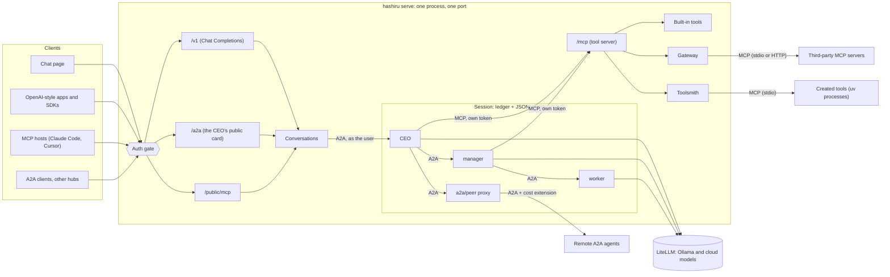
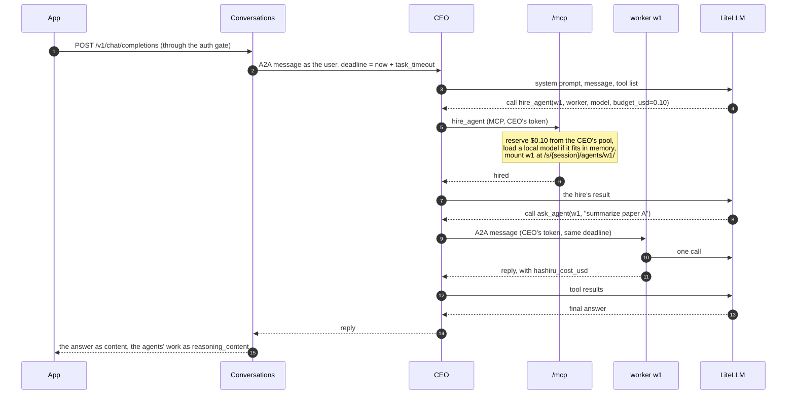

# Architecture

HASHIRU v2 is one process on one port (`hashiru serve`, default `127.0.0.1:9200`). Every agent in it is an A2A
service, every tool is an MCP tool, and the hiring tree decides who may spend what. This page shows how the parts
fit; the code is in `src/hashiru/`, and the README's *Layout* section maps modules to files.

## Components



- **Clients** reach only the public routes. The chat page is static files that use `/v1` like any other app.
- **Conversations** (`interop/conversations.py`) turn each chat, A2A context or MCP session into one hub session
  and send each new message to that session's CEO, as the user.
- **A session** is one hiring tree: a CEO, the agents it hired and theirs, a ledger of pools, and a trace file.
  Each agent is mounted as its own A2A app at `/s/{session}/agents/{name}/`, with its own Agent Card.
- **Hiring by difficulty** (`router.py`): a hiring agent says how hard a job is; the router picks the model from
  the `routing` order (or one built from `models`), within the modes, the hire's privacy and its pool, and moves a
  failing worker up that list.
- **Model recon** (`catalog.py`, `recon.py`): `hashiru models` lists what this machine can use (Ollama's pulled
  models that call tools; cloud models in LiteLLM's map whose provider key is set) with a tier from price or size,
  and `MODELS=auto` turns the picks into `models` and `routing` before the Hub is built (`recon.settle`). Only
  `--refresh` (LiteLLM's public map) and `--check` (each provider's model list) use the network.
- **Approvals** (`approvals.py`): a big cloud reservation, a big local model to load, or a turn that has spent its
  threshold pauses the agent that would spend. The conversation answers with the question and keeps the turn
  waiting; the user's next message decides it, and the paused work goes on (or is told no).
- **Plan mode** (`planning.py`): a planning turn offers the CEO only the tools that declare MCP's `readOnlyHint` (and
  memory search) plus `propose_plan`, and `runtime.perform` refuses every other call. `propose_plan` previews each
  hire through the router and the ledger without reserving anything. The plan waits in the session; the user's
  `approve` starts an act turn in which the planned hires need no further approval (`Approvals.planned`).
- **Plan graphs** (`program.py`, `plangraph.py`): the plan's steps (who gets which task, after which results) compile
  into hire, step, fire and answer nodes, with a join wherever a step needs several results, and the approved plan
  runs as a LangGraph graph inside the CEO's run. `runtime.PlanRunner` acts as the CEO: `perform` for `hire_agent`
  and `fire_agent`, `ask_agent` for each step, one tool-less CEO turn for the answer. LangGraph runs in supersteps
  (the ready nodes together, then the next ones). LangSmith tracing is held off for the run.
- **The CEO and managers** run a tool loop: an LLM turn, then every tool call it asked for, in parallel, until
  it replies (at most `max_turns`). **Workers** answer with one LLM call and no tools.
- **Tools** are served at `/mcp`. Managers reach them with their own bearer token, so the hub knows who is calling
  without trusting anything the model wrote. Third-party servers (`gateway.py`) and created tools
  (`toolsmith/`) are proxied there too, so an agent sees one tool list.
- **Remote agents** are hired like any other worker (`a2a/<peer>`). The hub mounts a proxy for each one, so the
  hirer talks to it at `/s/...` like any other hire and the hub can charge and trace every message.

## Protocols

| Who talks to whom | Protocol | Where |
|---|---|---|
| Apps → HASHIRU | OpenAI Chat Completions (SSE streaming) | `/v1/chat/completions`, `/v1/models` |
| A2A clients → HASHIRU | A2A JSON-RPC, streaming | card `/.well-known/agent-card.json` (also `/a2a/.well-known/...`), endpoint `/a2a` |
| MCP hosts → HASHIRU | MCP streamable HTTP | `/public/mcp` (`ask`, `end_session`, `hashiru://sessions/{id}`) |
| Agent → agent it hired | A2A JSON-RPC | `/s/{session}/agents/{name}/` |
| CEO or manager → tools | MCP streamable HTTP | `/mcp` |
| Hub → third-party tools | MCP stdio or streamable HTTP | `mcp_servers` in the config |
| Hub → created tools | MCP stdio, one `uv` process per tool | `tools_dir` |
| Hub → remote agents | A2A JSON-RPC + [cost extension](a2a-cost-extension.md) | `a2a_peers` in the config |
| Every agent → models | LiteLLM (`ollama_chat/...` is local, anything else is cloud) | `llm.py` |

## One request

What happens when an app sends *"Compare these two papers"* to `/v1/chat/completions`:



Every step writes an event (`llm`, `tool`, `msg`, `error`) to the session's JSONL trace in `trace_dir`; the chat
page's Agents panel and the streamed `reasoning_content` are both read from those events. One deadline covers
the whole request: every agent it reaches stops at the same time and replies that it ran out of time.

## Budgets

Each agent holds a dollar **reservation** carved from its hirer's pool. What an agent can still spend is

```
left(agent) = reserved − its own spend − what its hires hold
```

where a live hire holds its whole reservation and a fired one holds only what it (and everyone below it)
actually spent. Firing therefore returns the unspent part; money already paid to an API is not returned.

| Step | CEO left | m1 left |
|---|---|---|
| Session opens with `budget_usd = 0.50` | 0.50 | – |
| CEO spends 0.01 thinking | 0.49 | – |
| CEO hires manager m1 with 0.20 and worker w1 with 0.10 | 0.19 | 0.20 |
| m1 hires w2 with 0.05 and spends 0.02 | 0.19 | 0.13 |
| w1 spends 0.03, then the CEO fires it | 0.26 | 0.13 |

The checks are in code, not in prompts: a hire cannot reserve more than its hirer has left, an agent whose pool
is spent makes no more cloud calls, and a remote agent is paid from its own pool, which must cover its declared
price before each message. Local agents also hold the memory their model really uses (measured from Ollama), and a hire is refused
if the model does not fit in free memory. `max_usd` caps real API spend for the whole process. The ledger can be
rebuilt from a trace alone (`ledger.replay`), so budget rules can be checked after the fact.

## Trust boundaries

- **Public routes** need the `api_key` as a bearer token. Without one, the hub binds to loopback and answers only
  requests addressed to `127.0.0.1` or `localhost` from no page or its own page, which blocks DNS rebinding and
  cross-site requests. The chat page and the public card need no key.
- **Internal routes** (`/mcp`, `/s/...`) need a token the hub issued to one agent in one session. The caller of a
  tool is whoever owns the token, never a name the model supplies; an agent may only message agents it hired; a
  manager hired with `tools=[...]` cannot use, or give its hires, anything else.
- **Third-party MCP servers** get MCP's minimal environment plus only the variables you list, so your API keys
  stay out of them. Their results are labeled `untrusted` in the trace unless you say otherwise.
- **Remote agents** are pinned to the configured URL: the endpoint a peer's card names is ignored, so a card
  cannot redirect your credentials. Their replies are labeled `untrusted`.
- **Private data** (R3, *private stays local*) never reaches a cloud or remote model as it is. Where text moves
  (messages, replies, hire prompts, tool results, memory recall), `privacy.cross` obfuscates it on the way to the
  cloud (`obfuscation/`: Presidio patterns and a local model find the values, the session's vault swaps them for
  placeholders or generalizations) and restores it on the way back; with `private_mode=block`, or if detection fails,
  it refuses instead. An agent holding private data cannot call tools that leave the machine. A private chat stays
  private, also when its conversation is reopened. Refusals are `policy` events in the trace; the README lists what R3
  does not cover.
- **Created tools** run in their own `uv` environment without HASHIRU's environment variables, but as your user.
  That isolates dependencies, not the machine, which is why `tool_creation` is off by default.

A configured MCP server's `readOnlyHint` is trusted: a server that marks a writing tool read-only can act during
planning.

Known limits: one `api_key` is one trust domain (key holders can reach each other's conversations by id); the
Auth0 login of v1 was not ported; with several agents spending at once, `max_usd` can be exceeded by the calls already
in flight (one per agent).
